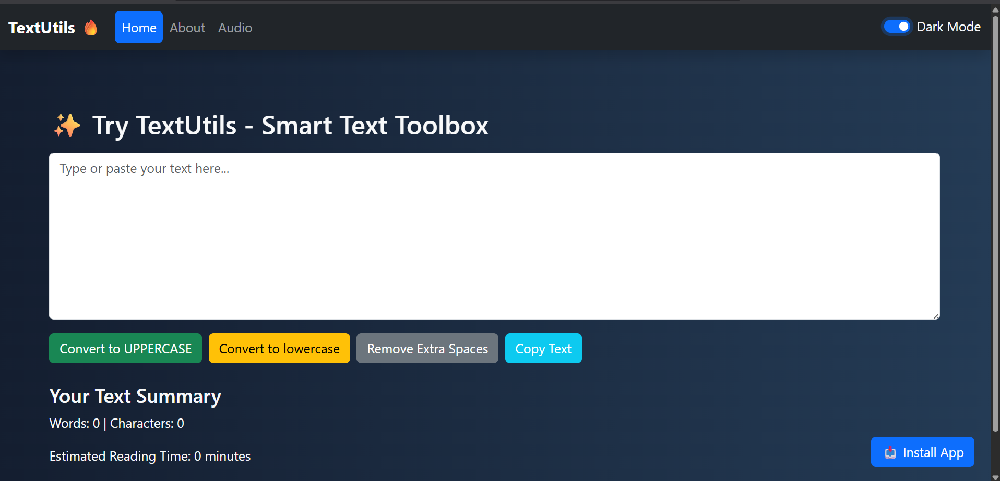

# TextUtils: React Text Toolbox

A React app for quick text utilities, with a light and dark theme, alerts and a separate audio upload page.

**Stack:** React 19, React Router, Bootstrap 5, React-Bootstrap, Create React App

## What the app is built to do

- Home page with a text toolbox (`TextForm`) for case conversion, word and character counts and clean-up
- About page and an audio upload page (`/audio`)
- Light and dark mode, saved in the browser so it persists between visits
- Timed alert messages for user actions

## Repository status

This repository currently holds the app entry files (`App.js`, `index.js`, styles, tests, `package.json`) and a screenshot. The `components/` folder and the `public/` folder that `App.js` imports from are not uploaded yet, so the app will not run from this repo alone until they are added.

## Run locally (once the missing folders are added)

Move `App.js`, `index.js`, `App.css` and `index.css` into a `src/` folder next to `public/`, then:

```bash
npm install
npm start
```

The app opens at http://localhost:3000.


